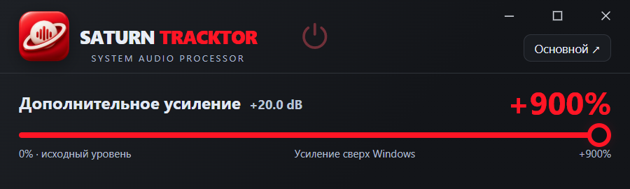
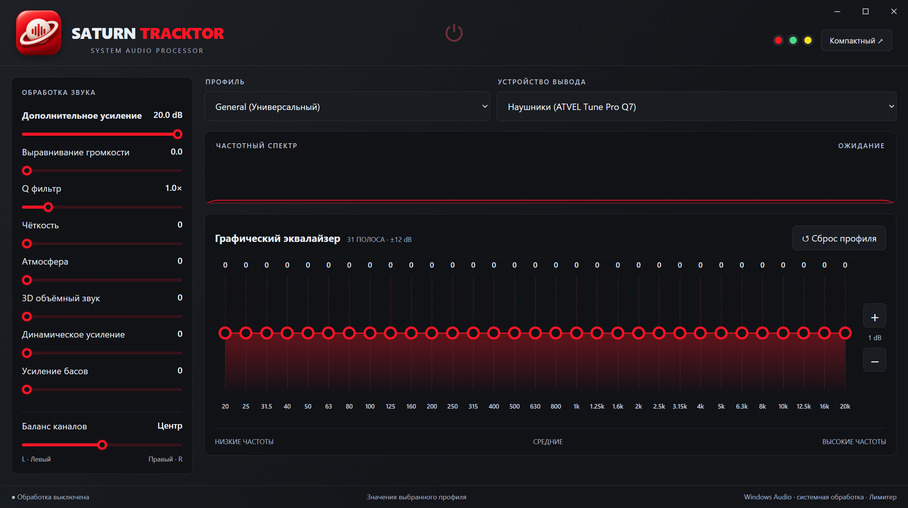

# Saturn Tracktor

Системный аудиопроцессор для **Windows 11 x64**. Автор: **Gevork Saturn**.

[Скачать установщик](https://github.com/manoilovic/saturn-tracktor/releases/latest) · [Исходники и лицензии](#лицензии)

## Установка

1. Скачайте `SaturnTracktor-Setup-1.0.2.exe` со страницы Releases и запустите.
2. При первой установке аудиокомпонента подтвердите стандартный запрос Windows. Драйвер находится внутри установщика.
3. Откройте Saturn Tracktor, выберите физические наушники или динамики и включите питание.

Установщик создаёт ярлыки на рабочем столе и в меню «Пуск», добавляет удаление в список приложений Windows. Программа устанавливается для всего компьютера в `C:\Program Files\SaturnTracktor`. Установка запрашивает права администратора. Если Windows запросит перезагрузку, выполните её перед включением обработки.

.NET включён. Microsoft WebView2 устанавливается автоматически, если отсутствует; только в этом случае нужен Интернет. Отдельная программа FxSound не устанавливается.

## Возможности

- 31 полоса эквалайзера, диапазон ±12 дБ. Кнопки +/− сдвигают все полосы на 1 дБ с ограничением на границах.
- Дополнительное усиление до +20 дБ, выравнивание громкости, Q фильтров, чёткость, атмосфера, расширение стерео, динамическое усиление, бас и баланс каналов.
- Различающиеся заводские профили и сохранение пользовательских профилей через меню выбора.
- «Сброс профиля» возвращает все регуляторы к сохранённым значениям выбранного профиля. Тема, устройство и другие профили сохраняются.
- Красная, зелёная и жёлтая темы. Включённое питание всегда светится зелёным.
- Компактный режим с одним большим ползунком. Размер 900 × 270 пикселей при масштабе Windows 150%.
- Процент дополнительного усиления: `(10^(dB/20) − 1) × 100%`. При +20 дБ отображается +900%.

## Как работает звук

Звук Windows поступает на виртуальный выход **Динамики (Saturn Audio Enhancer)**, обрабатывается собственным DSP и воспроизводится через выбранное физическое устройство. Используется WASAPI. Захвата вкладок браузера нет.

Лимитер ограничивает пики: при перегрузке фактический прирост будет меньше заданного. При паузе рендер аудиовыхода останавливается примерно через 1,4 секунды. При выключении или закрытии возвращается прежний выход Windows. Ручное переключение выхода пользователем учитывается.

Настройки сохраняются в `%LOCALAPPDATA%\SaturnTracktor`. Удаление программы сохраняет пользовательские настройки и общий виртуальный аудиодрайвер, которым могут пользоваться другие приложения.

## Проверка и ограничения

Проверено 18 октября 2026 года на Windows 11 build 26300, ATVEL Tune Pro Q7, 48 кГц, стерео:

- 12 проверок DSP, включая 31 фильтр, усиление, баланс, эффекты и лимитер.
- 11 проверок интерфейса, включая профили, сброс, сохранение пресета, общий сдвиг EQ и соответствие процентов децибелам.
- Реальный системный аудиотест: после +6 дБ входной пик 0,0005000 вырос до 0,00099763; тот же уровень измерен на физическом выходе. Проверены остановка выхода при паузе и восстановление маршрута Windows.
- Установка и удаление установщика, ярлыки, регистрация приложения, сохранение настроек. На компьютере с уже установленным драйвером повторная установка драйвера пропускается.

Проверка на чистой Windows без драйвера и WebView2 отдельно не проводилась. Не подтверждены Windows 10, ARM64, ASIO, эксклюзивный WASAPI и другие аудиоустройства. Автоматический запуск заставки по пользовательскому таймеру не наблюдался в отдельном длительном тесте. Программы, явно направленные на другой аудиовыход, могут обходить системный маршрут по умолчанию.

EXE и установщик не имеют сертификата подписи кода. Имя Gevork Saturn указано в метаданных. Встроенные драйвер и его установщик сохраняют исходные действительные подписи Microsoft/FxSound.

## Сборка

Инструкции: [BUILD.md](BUILD.md). Приложение: .NET 8, WinForms, WebView2, NAudio. Установщик: Inno Setup 6.7.3.

## Лицензии

Собственный код Saturn Tracktor: [MIT](LICENSE). Это собственная реализация DSP; алгоритмы FxSound один в один не воспроизводятся.

Неизменённые виртуальный драйвер FxSound и установочный helper поставляются как отдельные компоненты с исходными лицензиями AGPL-3.0 и Microsoft driver sample. Исходники включены в `ThirdParty`, а также в `SaturnTracktor-source.zip`, который устанавливается вместе с приложением. Имена поставщика и подписи драйвера сохраняются; изменяется отображаемое имя аудиовыхода.

NAudio: MIT. WebView2: лицензия Microsoft. .NET: лицензии Microsoft/.NET Foundation. См. [уведомления](SaturnTracktor/Assets/ThirdPartyNotices.txt), тексты в `SaturnTracktor/Assets` и `ThirdParty`.
